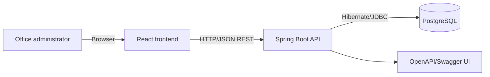
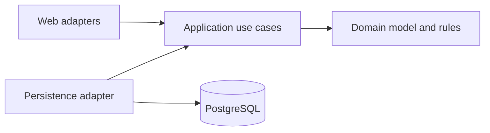

# 01 — Architecture Overview

## Architectural goals

The design optimizes for a small, understandable local application while preserving testable boundaries. It fulfills browser access (`C-1`), local-only execution (`BO-5`, `NFR-1.1`), persistent data (`BO-6`, `NFR-1.2`), and one-user/one-instance operation (`A-1`, `A-2`, `NFR-1.3`).

## System context

All components run on the same machine through Docker Compose. No component calls cloud or external application services.

## Container responsibilities

| Container | Responsibility | Technology |
|---|---|---|
| Frontend | Roster UI, forms, client validation, API interaction | React + TypeScript + Vite build; static web server |
| Backend | Business rules, orchestration, REST contracts, persistence | Java 21 + Spring Boot |
| Database | Durable employee records and uniqueness enforcement | PostgreSQL |

## Backend architectural style

Clean architecture dependencies point inward:

- **Domain:** `Employee`, `EmployeeStatus`, validation-independent business invariants.
- **Application:** create, edit, list, deactivate, and reactivate use cases plus ports.
- **Adapters:** REST controllers, OpenAPI models, Hibernate entities/repositories, Log4j integration.
- Spring configuration wires adapters to ports; domain and application code do not depend on Spring Data or HTTP.

## Primary request flow

1. The browser loads the roster and calls `GET /api/employees`.
2. The controller validates transport input and invokes a use case.
3. The use case enforces state and uniqueness rules through repository ports.
4. The persistence adapter commits via Hibernate/PostgreSQL.
5. The API maps results or errors to a stable JSON contract.
6. The frontend updates or reloads the roster and renders clear feedback.

## Deliberate exclusions

No authentication (`PAC-1`), authorization (`PAC-2`, `PAC-3`), delete endpoint (`BR-2`), distributed infrastructure, cloud deployment, concurrency design, search, filtering, or pagination (`BR-16`) is included.
