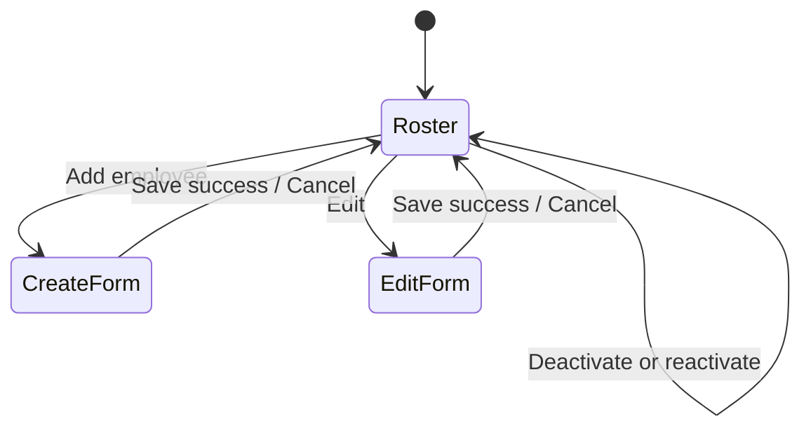

# 02 — Frontend Design

## Stack and structure

Use React with strict TypeScript and Vite. Vitest, React Testing Library, and `@testing-library/user-event` verify behavior. Suggested source layout:

```text
src/
  api/employeeApi.ts
  components/EmployeeTable.tsx
  components/EmployeeForm.tsx
  components/StatusBadge.tsx
  features/employees/EmployeeDirectoryPage.tsx
  features/employees/useEmployees.ts
  models/employee.ts
  App.tsx
```

## Page composition

`EmployeeDirectoryPage` owns roster loading, mutation coordination, and visible feedback. `EmployeeTable` displays one semantic table containing every employee (`FR-1.5`, `BR-13`). Rows show first name, last name, email, status badge, and contextual actions (`FR-1.6`, `BR-15`). `EmployeeForm` supports create and edit modes; status is never editable (`BR-10`).



## Client model

```typescript
type EmployeeStatus = "ACTIVE" | "INACTIVE";
interface Employee {
  email: string;
  firstName: string;
  lastName: string;
  status: EmployeeStatus;
}
```

Email is the resource identifier (`C-2`). API path segments must use `encodeURIComponent`.

## Interaction behavior

- Initial load shows loading, then the complete roster or a recoverable error with Retry (`UJ-1`).
- Create starts with empty fields and yields an Active employee (`FR-1.1`, `BR-9`, `UJ-2`).
- Edit is available for both statuses, prepopulates values, and preserves status (`FR-1.2`, `UJ-3`).
- Active rows expose Edit and Deactivate; inactive rows expose Edit and Reactivate (`BR-11`, `BR-12`).
- Successful mutation refreshes the canonical server-sorted roster. Buttons are disabled while their request is pending.
- No delete, status selector, search, filter, pagination, or separate inactive list is rendered (`BR-2`, `BR-10`, `BR-16`).

## Validation and errors

Trim names and email before submission. Require nonblank first and last names and a basic browser-side email check (`BR-3`–`BR-5`). Server validation remains authoritative. Map field errors beside controls; show conflict error `email: An employee with this email already exists` for HTTP 409 (`BR-8`). Unexpected failures produce a page/form alert without discarding entered values.

## Accessibility

Use labeled controls, native buttons, table headers, focus on the first invalid field, `aria-live` for outcome messages, and text in addition to color for status. A confirmation prompt before deactivation is recommended because it changes operational state, while remaining reversible.

## Frontend verification

Tests cover loading, empty roster, alphabetical rendering, status badges/actions, create/edit validation, conflict feedback, status transitions, failed requests, keyboard interaction, and absence of excluded controls. See [testing strategy](07-testing-strategy.md).
