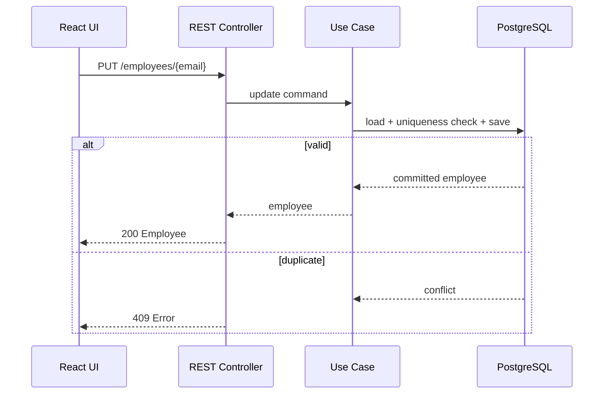

# 04 — API Design

## Conventions

Base path: `/api/employees`. JSON uses camelCase and UTF-8. Email identifiers in paths are URL-encoded. OpenAPI documents all schemas and responses; Swagger UI is available only on the local backend.

## Endpoints

| Operation | Method and path | Success | Errors | Requirements |
|---|---|---|---|---|
| List | `GET /api/employees` | `200` array | `500` | `FR-1.5`, `BR-13`–`BR-16` |
| Create | `POST /api/employees` | `201` + `Location` | `400`, `409`, `500` | `FR-1.1`, `BR-3`–`BR-6`, `BR-9` |
| Edit | `PUT /api/employees/{email}` | `200` | `400`, `404`, `409`, `500` | `FR-1.2`, `BR-7`, `BR-10` |
| Deactivate | `POST /api/employees/{email}/deactivate` | `200` | `404`, `409`, `500` | `FR-1.3`, `BR-11` |
| Reactivate | `POST /api/employees/{email}/reactivate` | `200` | `404`, `409`, `500` | `FR-1.4`, `BR-12` |

No `DELETE` endpoint exists (`BR-2`). List has no query parameters (`BR-16`).

## Schemas

Create request:

```json
{"firstName":"Ada","lastName":"Lovelace","email":"ada@example.test"}
```

Update request has the same shape. The path email identifies the existing record; body email is the desired email, allowing identity changes required by `FR-1.2`.

Employee response:

```json
{"firstName":"Ada","lastName":"Lovelace","email":"ada@example.test","status":"ACTIVE"}
```

Error response:

```json
{
  "timestamp":"2026-08-26T18:00:00Z",
  "status":409,
  "code":"EMAIL_CONFLICT",
  "message":"An employee with this email already exists.",
  "fieldErrors":{"email":"Email must be unique"},
  "path":"/api/employees"
}
```

`fieldErrors` is omitted when not applicable. Do not include stack traces or database details.

## Status semantics

- `400 Bad Request`: malformed JSON, missing/blank name, invalid email.
- `404 Not Found`: path email does not identify an employee.
- `409 Conflict`: duplicate email or an invalid state transition (for example deactivating an already inactive employee).
- `500 Internal Server Error`: unhandled server or persistence failure.

## Mutation sequence



The OpenAPI document is tested as part of backend integration tests to prevent contract drift.
