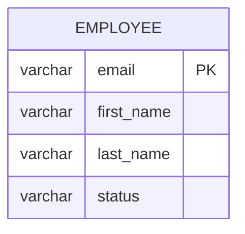

# 05 — Data Design

## Logical model



One table represents the single roster. There are no user, role, audit, or soft-delete tables.

## Physical schema

```sql
CREATE TABLE employee (
  email VARCHAR(254) PRIMARY KEY,
  first_name VARCHAR(100) NOT NULL,
  last_name VARCHAR(100) NOT NULL,
  status VARCHAR(8) NOT NULL,
  CONSTRAINT ck_employee_first_name_nonblank CHECK (btrim(first_name) <> ''),
  CONSTRAINT ck_employee_last_name_nonblank CHECK (btrim(last_name) <> ''),
  CONSTRAINT ck_employee_status CHECK (status IN ('ACTIVE', 'INACTIVE'))
);
```

Email is stored trimmed and lowercase. This makes uniqueness case-insensitive by normalization (`BR-1`, `BR-6`, `BR-7`) while preserving a simple primary key (`C-2`). The API returns the normalized value. Basic email format validation occurs before persistence (`BR-5`).

## Hibernate mapping

The persistence entity maps `email` with `@Id`, names as non-null columns, and status with `@Enumerated(EnumType.STRING)`. A mapper translates between the JPA entity and domain `Employee`; domain classes contain no persistence annotations.

## Queries and ordering

Roster retrieval uses:

```sql
SELECT email, first_name, last_name, status
FROM employee
ORDER BY lower(last_name), lower(first_name), lower(email);
```

This supplies deterministic alphabetical order (`BR-14`, `DR-Sort`) without pagination (`BR-16`). The expected data volume is local and small, so a separate ordering index is unnecessary initially.

## Lifecycle

Create inserts `ACTIVE`; edit updates names and optionally changes the primary-key email in one transaction; deactivate/reactivate updates only status. No SQL/JPA delete path is implemented (`BR-2`, `DR-Lifecycle`). PostgreSQL data lives in a named Docker volume so it survives container replacement and application restarts (`NFR-1.2`, `DR-Persistence`).

## Schema management and recovery

Use versioned Flyway migrations executed by the backend at startup; Hibernate schema generation is validation-only. The initial migration creates the table and constraints. A user can back up local data with `pg_dump` and restore with `pg_restore`; exact convenience script names are implementation details, not required product behavior.
