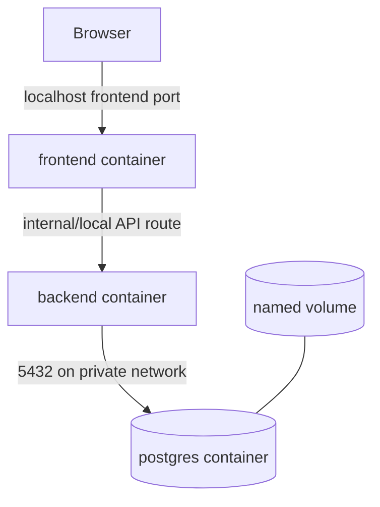

# 08 — Local Containerization

## Scope

Docker packages the frontend and backend; Docker Compose runs them with PostgreSQL on one machine (`BO-5`, `NFR-1.1`). Cloud and production infrastructure design are out of scope.

## Images

- **Frontend:** multi-stage Node build runs Vite, then copies static assets into an unprivileged web-server image. Configure `/api` reverse proxying to backend so the browser has one local origin.
- **Backend:** multi-stage Maven/Gradle build produces the Spring Boot artifact; runtime uses a Java 21 JRE image and a non-root user.
- **PostgreSQL:** pin a supported major image version in implementation; persist `/var/lib/postgresql/data` to a named volume.

## Compose services

`frontend` depends on healthy `backend`; `backend` depends on healthy `db`. Only the frontend host port must be user-facing. Backend may expose a localhost-bound port for Swagger and diagnostics. PostgreSQL need not publish a host port unless local administration is explicitly enabled.

Environment configuration supplies database credentials and URLs. A checked-in `.env.example` may contain non-secret local defaults; real `.env` files are ignored. Health checks use frontend HTTP, Spring Boot health, and `pg_isready`.

## Startup and shutdown

1. Build/start with `docker compose up --build`.
2. PostgreSQL becomes ready.
3. Backend connects, runs Flyway migrations, validates mappings, and becomes healthy.
4. Frontend becomes available and the browser loads the roster.
5. Stop with `docker compose down`; omit `-v` so records remain.

Removing the named volume is an explicit destructive maintenance action, never an application feature (`BR-2`). Document this warning next to any reset command.

## Local persistence and recovery

The named PostgreSQL volume survives normal restarts and image/container recreation (`BO-6`, `NFR-1.2`). Backup and restore commands execute against the local database container. No remote registry, hosted database, telemetry service, or cloud resource is required.

## Implementation verification

Compose acceptance checks cover clean startup, health ordering, UI-to-API connectivity, create/read behavior, restart persistence, and graceful failure messaging when backend/database is unavailable.
